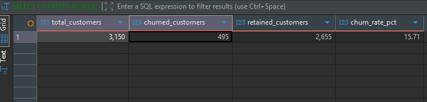
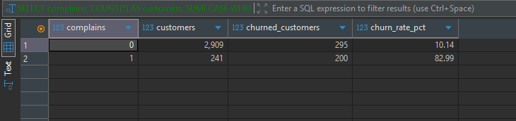
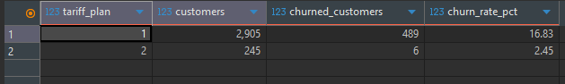

# Telecom Customer Churn Analysis - Findings

## Overview

This analysis investigates customer churn using the analysis-ready
`analytics.customer_churn` dataset.

The objective is to understand how churn varies across customer
characteristics, service experience, usage behaviour, subscription
length and customer value.

The analysis focuses on associations observed within the dataset.
The results should not be interpreted as evidence that any individual
factor directly causes customer churn.

======================================================================

## 1. Overall Customer Churn

### Business Question

What proportion of customers churned?

### Result

total_customers|churned_customers|retained_customers|churn_rate_pct|
---------------+-----------------+------------------+--------------+
           3150|              495|              2655|         15.71|

- Total customers: 3,150
- Churned customers: 495
- Retained customers: 2,655
- Overall churn rate: 15.71%

### Observation

Of the 3,150 customers, 495 (15.71%) churned and 2,655 (84.29%) were
retained.

### Interpretation

The overall churn rate provides a baseline for comparing customer
segments. Segment rates materially above 15.71% warrant closer
investigation, while also considering each segment's size.

### Business Implication

Use 15.71% as the reference rate when prioritizing segments for further
analysis and evaluating retention initiatives. This dataset-level rate
is a benchmark, not a forecast of churn in another customer population.

======================================================================

## 2. Complaints and Churn

### Business Question

Is churn different between customers who complained and customers
who did not complain?

### Result

complains|customers|churned_customers|churn_rate_pct|
---------+---------+-----------------+--------------+
        0|     2909|              295|         10.14|
        1|      241|              200|         82.99|

### Observation

Customers who submitted complaints had a churn rate of 82.99% (200 of
241), compared with 10.14% (295 of 2,909) among customers without
complaints.

The difference between the two groups was 72.85 percentage points.

### Interpretation

The complaint group had a substantially higher churn rate: about 8.2
times the rate among customers without complaints. This is a strong
association in this dataset, but it does not demonstrate that complaints
cause churn. The complaint group is also comparatively small, with 241
customers.

### Business Implication

Complaint records could be used to prioritize timely service recovery
and follow-up, while validating the relationship across complaint
severity, timing, and customer characteristics. The result supports
investigating complaint handling as a retention opportunity, not assuming
that complaint resolution alone will prevent churn.

Additional analysis should examine whether complaint behaviour remains associated with churn after considering customer value, usage, tenure and other characteristics.

----------------------------------------------------------------

## 3. Tariff Plan and Churn

### Business Question

Does customer churn vary across tariff plans?

### Result

tariff_plan|customers|churned_customers|churn_rate_pct|
-----------+---------+-----------------+--------------+
          1|     2905|              489|         16.83|
          2|      245|                6|          2.45|

### Observation

Customers on tariff plan 1 recorded a churn rate of 16.83% (489 of
2,905), while customers on tariff plan 2 recorded a churn rate of 2.45%
(6 of 245).

### Interpretation

The churn rate for tariff plan 1 was 14.38 percentage points higher than
for tariff plan 2. Tariff plan is associated with different churn
outcomes in this dataset; however, only six churn events occurred among
plan 2 customers, so that estimate should be treated cautiously.

### Business Implication

Investigate plan 1 customers alongside tenure, customer value,
complaints, and usage before considering any tariff changes. Validate
the plan 2 comparison with additional data because its churned-customer
count is small.

-----------------------------------------------------------------

## 4. Age Group and Churn

### Business Question

How does churn vary across customer age groups?

### Result

age_group|customers|churned_customers|retained_customers|churn_rate_pct|
---------+---------+-----------------+------------------+--------------+
        1|      123|                0|               123|          0.00|
        2|     1037|              184|               853|         17.74|
        3|     1425|              230|              1195|         16.14|
        4|      395|               79|               316|         20.00|
        5|      170|                2|               168|          1.18|

### Observation

The highest churn rate occurred in age group 4 at 20.00% (79 of 395).

The lowest churn rate occurred in age group 1 at 0.00% (0 of 123).

### Interpretation

Age groups 2, 3, and 4 had churn rates between 16.14% and 20.00%.
Age groups 1 and 5 recorded substantially lower observed churn rates, at 0.00% and 1.18%, respectively. These groups also contained fewer customers than age groups 2 and 3, so the differences should be interpreted alongside segment size

The difference between the highest and lowest age-group churn rates
was 20.00 percentage points.

### Business Implication

Age group can be considered as one dimension in broader segmentation.
Before using these differences to guide outreach, validate the group
definitions and rates on additional data, especially for the smaller
groups. Age alone is not sufficient evidence for targeting customers.

------------------------------------------------------------------------

## 5. Customer Status and Churn

### Business Question

How does churn vary according to customer status?

### Result

status|customers|churned_customers|churn_rate_pct|
------+---------+-----------------+--------------+
     1|     2368|              125|          5.28|
     2|      782|              370|         47.31|

### Observation

Status category 1 recorded a churn rate of 5.28% (125 of 2,368), while
status category 2 recorded a churn rate of 47.31% (370 of 782), a
difference of 42.03 percentage points.

### Interpretation

Customers in status category 2 had nearly nine times the churn rate of
customers in category 1. This is a substantial association in the
dataset. Status 1 represents active customers and Status 2 represents non-active customers. Non-active customers recorded a churn rate of 47.31%, compared with 5.28% among active customers, an observed difference of 42.03 percentage points.
### Business Implication

After confirming the category definitions and that status is available
before the churn outcome, status may help prioritize retention
monitoring alongside usage, complaints, tenure, and customer value.
Check for target leakage before using it in a predictive model or
operational early-warning process.

-------------------------------------------------------------------------

## 6. Subscription Length and Churn

### Business Question

Do churned customers have a different average subscription length
from retained customers?

### Result

| churn|customers|avg_subscription_length|min_subscription_length|max_subscription_length|
-----+---------+-----------------------+-----------------------+-----------------------+
    0|     2655|                  32.66|                      3|                     47|
    1|      495|                  31.89|                      3|                     45|

### Observation

Retained customers had an average subscription length of 32.66 months, while churned customers averaged 31.89 months.

The average difference was 0.77 months, with retained customers having a marginally longer average subscription length.

### Interpretation

The average subscription lengths were similar, with churned customers
showing a modestly shorter average. The small difference in means alone
does not establish that newer customers are more likely to churn; the
reported ranges also overlap substantially.

### Business Implication

Do not infer an early-lifecycle churn problem from these averages alone.
Compare churn rates across subscription-length bands to identify whether
particular lifecycle stages warrant focused onboarding or retention
support.

------------------------------------------------------------------------

## 7. Customer Value and Churn

### Business Question

Does customer value differ between churned and retained customers?

### Result

churn|customers|avg_customer_value|min_customer_value|max_customer_value|
-----+---------+------------------+------------------+------------------+
    0|     2655|            535.51|              0.00|           2165.28|
    1|      495|            124.81|              0.00|            987.26|
### Observation

Customer value shows a substantial separation between retained and churned customers in this dataset. Retained customers had an average customer value of 535.51, compared with 124.81 among churned customers, a difference of 410.70.

### Interpretation

This makes customer value particularly important for subsequent segmentation. However, averages alone do not reveal how customer value is distributed, so quartile analysis should be used to determine whether the relationship is consistent across the customer base or driven by extreme observations.

### Business Implication

Use customer value to add commercial context to churn counts and to
compare churn across value segments. Because churned customers had a
lower average value in this dataset, retention prioritization should
consider both customer value and churn likelihood rather than assuming
that churn is concentrated among the highest-value customers. A
customer-value quartile analysis would help refine this assessment.

----------------------------------------------------------------------------------

## 8. Usage Behaviour and Churn

### Business Question

How does average usage behaviour differ between churned and retained
customers?

### Result

churn|customers|avg_seconds_of_use|avg_frequency_of_use|avg_frequency_of_sms|avg_distinct_called_numbers|
-----+---------+------------------+--------------------+--------------------+---------------------------+
    0|     2655|           5014.22|               76.98|               83.87|                      25.58|
    1|      495|           1566.63|               29.13|               15.80|                      12.39|

### Observation

Churned customers had lower averages than retained customers across all
four usage measures:

- Seconds of use: 1,566.63 for churned customers versus 5,014.22 for
  retained customers (3,447.59 fewer on average).
- Frequency of use: 29.13 versus 76.98 (47.85 fewer).
- SMS frequency: 15.80 versus 83.87 (68.07 fewer).
- Distinct called numbers: 12.39 versus 25.58 (13.19 fewer).

### Interpretation

Across these measures, churned customers appear less engaged on average
than retained customers. This pattern is consistent across the reported
usage metrics, but does not establish that lower usage causes churn or
that usage alone can identify customers who will churn.

Usage variables should be evaluated together rather than assuming that
one usage measure independently explains churn.

### Business Implication

Usage measures could be evaluated as potential inputs to customer
engagement monitoring, alongside complaints, status, tenure, and
customer value. Any early-warning use should be validated on later
periods using only information available before the churn outcome.

===========================================================
### Executive Summary
The analysis covers 3,150 telecom customers, of whom 495 churned, representing an overall churn rate of 15.71%.

The strongest preliminary churn differences observed in the SQL analysis include:

Complaint behaviour: customers with complaints recorded an 82.99% churn rate compared with 10.14% among customers without complaints.

Customer status: non-active customers recorded a 47.31% churn rate compared with 5.28% among active customers.

Customer value: churned customers had substantially lower average customer value (124.81) than retained customers (535.51).

Usage behaviour: churned customers recorded lower average usage across seconds of use, frequency of use, SMS frequency and distinct called numbers.

Tariff plan: Plan 1 recorded a 16.83% churn rate compared with 2.45% for Plan 2.

Subscription length showed only a small difference in the preliminary mean comparison, suggesting that tenure should be examined using customer segments rather than averages alone.

===========================================================
===========================================================
===========================================================
## Customer Segmentation Findings
## Overview
Following the initial churn analysis, customer segmentation was performed to determine whether churn patterns become clearer when customers are grouped by lifecycle stage, customer value, tariff plan, complaint behaviour, and customer status.

The overall churn rate of 15.71% is used as the baseline for comparing segment performance.

These results describe associations within this dataset and should not be interpreted as evidence of causation.

======================================================================

12. Tenure Segmentation
Business Question
How does churn vary across customer lifecycle stages?

## Result
tenure_segment|customers|churned_customers|retained_customers|churn_rate_pct|
--------------+---------+-----------------+------------------+--------------+
0-12 months   |      140|               54|                86|         38.57|
13-24 months  |      361|               10|               351|          2.77|
25-36 months  |     1448|              273|              1175|         18.85|
37-48 months  |     1201|              158|              1043|         13.16|

## Observation
The highest observed churn rate occurred within the 0-12 months segment at 38.57%, representing 54 churned customers out of 140.

The lowest observed churn rate occurred within the 13-24 months segment at 2.77%, representing 10 churned customers out of 361.

The 0-12 month segment was 22.86 percentage points above the baseline.
The 13-24 month segment was 12.94 percentage points below the baseline.
The 25-36 month segment was 3.14 percentage points above the baseline.
The 37-48 month segment was 2.55 percentage points below the baseline.

Vs overall churn rate for the complete customer population was 15.71%.

## Interpretation
The earlier comparison of average subscription length showed only a small difference between churned and retained customers: 31.89 months for churned customers compared with 32.66 months for retained customers.

Tenure segmentation reveals a pattern that was hidden by those averages. Customers in the first 12 months recorded the highest observed churn, while the 13-24 month segment recorded the lowest churn.

The relationship is not linear. Churn does not consistently decrease as subscription length increases because the rate rises again to 18.85% among customers in the 25-36 month segment before falling to 13.16% in the 37-48 month segment.

The 0-12 month segment contains only 140 customers, so its high churn rate should be interpreted alongside its comparatively small population.

## Business Implication
The first 12 months represent a potential customer-lifecycle risk period and warrant deeper investigation into onboarding, early service experience, complaint handling, usage development, and tariff-plan mix.

The 25-36 month segment also requires attention because it contains 1,448 customers and recorded a churn rate above the overall baseline. Although its churn rate is lower than the 0-12 month segment, its larger population means it accounts for more churned customers.

Retention planning should therefore consider both:

Churn rate, which identifies concentrated risk; and
Churn volume, which shows where the largest number of customers may be affected.

======================================================================

13. Customer Value Segmentation
Business Question
How does churn vary across customer-value quartiles?

Method
Customers were ordered by customer value and divided into four approximately equal-sized groups using PostgreSQL's NTILE(4) window function.

Quartile 1 represents relatively lower-value customers.
Quartile 4 represents relatively higher-value customers.

## Result
value_quartile|customers|min_customer_value|avg_customer_value|max_customer_value|churned_customers|churn_rate_pct|
--------------+---------+------------------+------------------+------------------+-----------------+--------------+
             1|      788|              0.00|             52.60|            113.80|              276|         35.03|
             2|      788|            113.81|            167.89|            228.48|              142|         18.02|
             3|      787|            228.56|            416.63|            788.49|               72|          9.15|
             4|      787|            789.84|           1247.68|           2165.28|                5|          0.64|

## Observation
The highest churn rate occurred in Quartile 1 at 35.03%, with 276 churned customers out of 788.

The lowest churn rate occurred in Quartile 4 at 0.64%, with only 5 churned customers out of 787.

Churn declined consistently as customer value increased:

Q1: 35.03%
Q2: 18.02%
Q3: 9.15%
Q4: 0.64%
The lowest-value quartile accounted for 276 of the 495 churned customers, or approximately 55.76% of all observed churn.

Quartiles 1 and 2 together accounted for 418 churned customers, or approximately 84.44% of all observed churn.

## Interpretation
The quartile results strongly support the original average comparison, where churned customers had an average customer value of 124.81 compared with 535.51 among retained customers.

The relationship is visible across the full customer-value distribution, not only in the group averages. Each successive increase in customer-value quartile is associated with a lower observed churn rate.

However, the results do not prove that lower customer value causes churn. Customer value may reflect underlying engagement, usage, tariff, tenure, or other behavioural characteristics.

## Business Implication
Customer value is a useful commercial dimension for understanding churn, but it introduces an important prioritization trade-off.

The lowest-value segments contain most of the observed churn, while the highest-value segment has very little observed churn. A retention strategy should therefore distinguish between:

High-volume churn management, focused on reducing churn across lower-value segments;
Value protection, focused on safeguarding commercially valuable customers even where their observed churn rate is relatively low; and
Growth opportunities, focused on improving engagement and value among lower-value customers where commercially justified.
Retention activity should not be prioritized solely by churn rate or customer value. Both dimensions should be considered together.
======================================================================

14. Tariff Plan and Complaint Segmentation
Business Question
How does churn vary when tariff plan and complaint behaviour are considered together?

## Result
tariff_plan|complains|customers|churned_customers|retained_customers|churn_rate_pct|
-----------+---------+---------+-----------------+------------------+--------------+
          1|        1|      222|              194|                28|         87.39|
          2|        1|       19|                6|                13|         31.58|
          1|        0|     2683|              295|              2388|         11.00|
          2|        0|      226|                0|               226|          0.00|

## Observation
The group with the highest observed churn was Tariff Plan 1 customers with complaints, at 87.39%. This group contained 222 customers, of whom 194 churned.

The lowest observed churn occurred among Tariff Plan 2 customers without complaints, where none of the 226 customers churned.

Within Tariff Plan 1:

Customers with complaints recorded 87.39% churn.
Customers without complaints recorded 11.00% churn.
The difference was 76.39 percentage points.
Within Tariff Plan 2:

Customers with complaints recorded 31.58% churn.
Customers without complaints recorded 0.00% churn.
The difference was 31.58 percentage points.

## Interpretation
Complaint history separates high- and low-churn groups within both tariff plans.

Tariff Plan 1 customers with complaints recorded the highest churn rate and also represented a meaningful segment of 222 customers. This suggests that the higher overall churn observed for Tariff Plan 1 is particularly concentrated among customers with complaint history.

Tariff Plan 2 customers with complaints also recorded churn above the 15.71% overall baseline. However, this segment contained only 19 customers, so its 31.58% rate should be interpreted cautiously.

The 0.00% rate among Tariff Plan 2 customers without complaints describes the observed dataset and should not be interpreted as a guarantee of zero future churn.

## Business Implication
Complaint history appears more useful when combined with tariff plan than tariff plan is when considered alone.

Retention investigation should prioritize Tariff Plan 1 customers with complaints because the segment combines:

a high observed churn rate;
a meaningful customer population;
and a large number of churned customers.
The underlying reasons for complaints should be examined before changing pricing or tariff structures. The results support targeted service recovery and complaint-resolution analysis rather than broad tariff changes based only on churn rates.

======================================================================

15. Customer Status and Complaint Segmentation
Business Question
How does churn vary when customer status and complaint behaviour are considered together?

## Result

status|complains|customers|churned_customers|retained_customers|churn_rate_pct|
------+---------+---------+-----------------+------------------+--------------+
     2|        1|      158|              141|                17|         89.24|
     1|        1|       83|               59|                24|         71.08|
     2|        0|      624|              229|               395|         36.70|
     1|        0|     2285|               66|              2219|          2.89|

## Observation
TThe highest observed churn occurred among non-active customers with complaints, at 89.24%. Of the 158 customers in this segment, 141 churned.

The lowest observed churn occurred among active customers without complaints, at 2.89%. Of the 2,285 customers in this segment, 66 churned.

All groups except active customers without complaints recorded churn above the overall baseline of 15.71%.

Complaint history was associated with higher churn within both status categories:

Among non-active customers, complaint history was associated with an increase from 36.70% to 89.24%.
Among active customers, complaint history was associated with an increase from 2.89% to 71.08%.
## Interpretation
Combining customer status and complaint behaviour creates substantially greater separation between customer groups than examining either variable in isolation.

Complaint history is associated with high churn even among active customers. At the same time, non-active customers without complaints still recorded a relatively high churn rate of 36.70%.

This suggests that complaint behaviour and customer status may capture different, overlapping dimensions of customer risk.

The status variable requires temporal validation. If customer status was determined at or after the churn outcome, using it in predictive analysis would create target leakage.

## Business Implication
If status is available before the churn outcome, the four profiles could support differentiated retention responses:

Complaint + Non-Active: urgent service recovery and retention investigation;
Complaint + Active: complaint resolution before activity declines;
No Complaint + Non-Active: engagement or reactivation investigation;
No Complaint + Active: routine monitoring rather than intensive intervention.
These are exploratory analytical profiles. Their operational use should depend on confirming data timing, segment stability, and the commercial value of each group.

======================================================================

16. Complaint Segments Compared With Overall Churn
Business Question
How far above or below the overall churn rate is each complaint group?

## Result
complains|customers|churn_rate_pct|overall_churn_rate_pct|difference_percentage_points|
---------+---------+--------------+----------------------+----------------------------+
        1|      241|         82.99|                 15.71|                       67.27|
        0|     2909|         10.14|                 15.71|                       -5.57|

## Observation
Customers with complaints recorded churn 67.27 percentage points above the overall churn baseline.

Customers without complaints recorded churn 5.57 percentage points below the baseline.

Although the complaint group represented only 241 of the 3,150 customers, it accounted for 200 of the 495 churned customers.

## Interpretation
The complaint group shows one of the largest observed departures from the overall churn rate.

The result confirms that complaint behaviour provides strong analytical separation in this dataset. However, it remains an association rather than evidence that complaints directly cause churn.

The difference may also reflect complaint severity, unresolved service issues, customer value, usage reduction, tariff plan, or customer status.

## Business Implication
Complaint records could support prioritization for customer-service follow-up and retention investigation.

Further analysis should examine:

complaint type and severity;
complaint resolution time;
repeat complaints;
whether a complaint was resolved;
time between complaint and churn;
customer value and usage before complaint submission.
These fields are not present in the current dataset, so the existing analysis cannot determine which aspects of complaint handling are most important.

======================================================================

17. Tariff Segments Compared With Overall Churn
Business Question
How far above or below the overall churn rate is each tariff plan?

Result
tariff_plan|customers|churn_rate_pct|overall_churn_rate_pct|difference_percentage_points|
-----------+---------+--------------+----------------------+----------------------------+
          1|     2905|         16.83|                 15.71|                        1.12|
          2|      245|          2.45|                 15.71|                      -13.27|

## Observation
Tariff Plan 1 recorded churn 1.12 percentage points above the overall churn rate.

Tariff Plan 2 recorded churn 13.27 percentage points below the overall churn rate.

Tariff Plan 1 contained 2,905 customers and 489 of the 495 churn events. Tariff Plan 2 contained 245 customers and only six churn events.

## Interpretation
Although the difference between the two tariff plans is large, the Tariff Plan 1 rate is only slightly above the overall baseline because Plan 1 represents most of the customer population.

The low observed churn for Plan 2 is based on only six churn events. The estimate should therefore be interpreted cautiously and validated using additional observations.

The tariff-and-complaint segmentation also shows that complaint history creates substantial differences within each tariff plan. This suggests that tariff type alone provides an incomplete explanation of churn.

## Business Implication
Tariff plan can contribute to segmentation but should not be used as an isolated retention rule.

For practical prioritization, tariff information should be combined with:

complaint history;
customer status;
customer value;
usage indicators;
and subscription length.
The results do not support changing a tariff offering solely because one plan recorded a higher churn rate.

======================================================================

18. Status Segments Compared With Overall Churn
Business Question
How far above or below the overall churn rate is each customer-status group?

## Result

status|customers|churn_rate_pct|overall_churn_rate_pct|difference_percentage_points|
------+---------+--------------+----------------------+----------------------------+
     2|      782|         47.31|                 15.71|                       31.60|
     1|     2368|          5.28|                 15.71|                      -10.44|

## Observation
Non-active customers recorded churn 31.60 percentage points above the overall baseline.

Active customers recorded churn 10.44 percentage points below the overall baseline.

The non-active group accounted for 370 of the 495 churned customers, while active customers accounted for 125.

## Interpretation
Customer status provides substantial separation between the observed churn rates of the two groups.

However, the analytical usefulness of status depends on when it was measured. A strong relationship with churn is useful only if status is available before the churn outcome.

If status is determined as part of, or after, churn classification, the field would reveal information about the target and create target leakage.

## Business Implication
If status is genuinely available before churn, non-active customers could be prioritized for engagement and retention investigation.

Before operational or predictive use, the following must be confirmed:

The definition of active and non-active status;
When status was measured;
How often status changes;
Whether the status definition directly incorporates churn behaviour.
Until those questions are resolved, status should remain an exploratory segmentation variable.

======================================================================

19. Multi-Factor Customer Profiles
Business Question
What churn patterns emerge when complaint behaviour and customer status are combined into customer profiles?

Customer Profiles
The following profiles were created:

Complaint + Non-Active
Complaint + Active
No Complaint + Non-Active
No Complaint + Active
## Result
customer_profile         |customers|churned_customers|retained_customers|churn_rate_pct|
-------------------------+---------+-----------------+------------------+--------------+
Complaint + Non-Active   |      158|              141|                17|         89.24|
Complaint + Active       |       83|               59|                24|         71.08|
No Complaint + Non-Active|      624|              229|               395|         36.70|
No Complaint + Active    |     2285|               66|              2219|          2.89|

## Observation
The profile with the highest observed churn was Complaint + Non-Active, at 89.24%.

The profile with the lowest observed churn was No Complaint + Active, at 2.89%.

The two complaint profiles recorded high churn regardless of customer status:

Complaint + Non-Active: 89.24%
Complaint + Active: 71.08%
Non-active customers without complaints also recorded churn of 36.70%, which remained materially above the overall baseline.

## Interpretation
The combined profiles provide meaningful additional separation between customers.

Complaint history appears strongly associated with churn across both status groups. Customer status also adds information because non-active customers without complaints still display higher churn than active customers without complaints.

The No Complaint + Active profile contains 2,285 customers, representing most of the dataset, and recorded the lowest churn rate. This group can serve as a low-risk comparison segment for further analysis.

The Complaint + Active profile contains only 83 customers, so its 71.08% churn rate should be interpreted alongside its smaller population.

# Business Implication
Multi-factor profiles are more actionable than single-variable segments because they distinguish between different potential retention needs.

An exploratory prioritization framework could be:

Complaint + Non-Active: highest-priority investigation;
Complaint + Active: early service-recovery opportunity;
No Complaint + Non-Active: engagement or reactivation opportunity;
No Complaint + Active: low-intensity monitoring.
This framework should not be deployed as an automated decision rule without validating status timing, segment stability, customer value, and intervention costs.

======================================================================

20. Customer Profiles Compared With Overall Churn
Business Question
Which customer profiles have churn rates materially above or below the 15.71% overall churn baseline?

## Result
customer_profile         |customers|churn_rate_pct|overall_churn_rate_pct|difference_percentage_points|
-------------------------+---------+--------------+----------------------+----------------------------+
Complaint + Non-Active   |      158|         89.24|                 15.71|                       73.53|
Complaint + Active       |       83|         71.08|                 15.71|                       55.37|
No Complaint + Non-Active|      624|         36.70|                 15.71|                       20.98|
No Complaint + Active    |     2285|          2.89|                 15.71|                      -12.83|

## Observation
The largest positive difference relative to overall churn occurred within the Complaint + Non-Active profile, which was 73.53 percentage points above the overall churn rate.

The No Complaint + Active profile recorded the lowest relative churn rate, at 12.83 percentage points below the baseline.

Three of the four profiles recorded churn above the overall baseline. Only the No Complaint + Active group recorded churn below it.

## Interpretation
The profile comparison clearly separates customer groups with very different observed churn outcomes.

The results also show why segment size and churn rate must be reviewed together:

Complaint + Non-Active has the highest rate but 158 customers.
No Complaint + Non-Active has a lower rate of 36.70% but contains 624 customers and 229 churn events.
Complaint + Active has high churn but contains only 83 customers.
No Complaint + Active contains most customers but has the lowest observed churn rate.
Therefore, the highest churn rate does not automatically identify the segment with the largest churn volume or business impact.

## Business Implication
Retention prioritization should balance:

Risk concentration, measured through churn rate;
Customer volume, measured through segment size and churn count;
Commercial impact, measured through customer value;
Actionability, based on whether the business can address the underlying issue; and
Data validity, especially the timing of customer status.
The Complaint + Non-Active profile represents the highest concentration of observed churn risk.

The No Complaint + Non-Active profile represents a broader population with substantial churn volume and may require a different re-engagement strategy.
======================================================================

Segmentation Summary
The segmentation analysis extends the initial churn analysis by moving from individual customer characteristics to lifecycle segments, commercial-value groups, and multi-factor customer profiles.

Key Segmentation Findings
1. Highest-churn tenure segment:
Customers in the 0-12 month segment, with a churn rate of 38.57%.

2. Largest tenure-related churn volume:
Customers in the 25-36 month segment, with 273 churned customers and a churn rate of 18.85%.

3. Highest-churn customer-value quartile:
Quartile 1, the lowest-value quartile, with a churn rate of 35.03%.

4. Lowest-churn customer-value quartile:
Quartile 4, the highest-value quartile, with a churn rate of 0.64%.

5. Highest-churn tariff/complaint combination:
Tariff Plan 1 customers with complaints, with a churn rate of 87.39%.

6. Highest-churn status/complaint combination:
Non-active customers with complaints, with a churn rate of 89.24%.

7. Highest-churn customer profile:
Complaint + Non-Active, with a churn rate of 89.24%.

8. Largest positive difference from overall churn:
Complaint + Non-Active, at 73.53 percentage points above the overall churn rate.

9. Largest low-risk profile:
No Complaint + Active, containing 2,285 customers and recording a churn rate of 2.89%.

10. Most consistent commercial pattern:
Churn declined progressively as customer value increased, from 35.03% in Quartile 1 to 0.64% in Quartile 4.